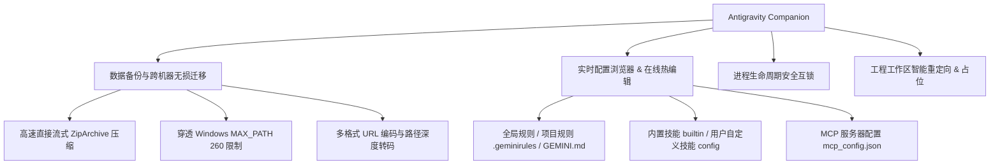
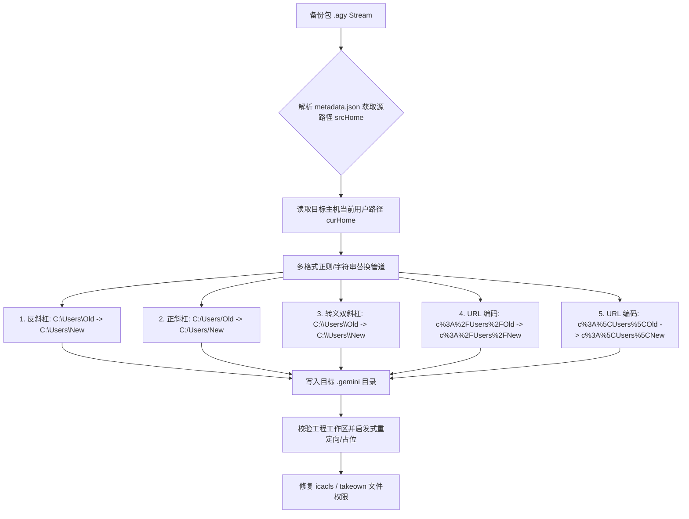

# Antigravity Companion 使用说明书 (V0.4.1)

## 一、 软件概述

**Antigravity Companion** 是专为 Google DeepMind Antigravity (Gemini Code Assistant / AGY) 全生态打造的一站式本地伴侣、数据迁移与配置管理工具。

本工具基于 C# WinForms 原生开发，无任何 Python、Node.js 或第三方 DLL 依赖，为纯原生单文件绿色便携程序。免安装、即开即用，全面兼容 Windows 7 / 10 / 11 操作系统。



### 核心特性

1. **跨机器数据无损迁移与自动重映射**：
   - 完整备份历史对话（`conversations/*.db`）、会话脑区（`brain/` 记忆、推理轨迹与上下文）、会话索引（`agyhub_summaries_proto.pb`、`antigravity_state.pbtxt`）、全局规则、用户技能及 MCP 插件。
   - 彻底攻克跨机器迁移后“历史对话丢失、会话失效、侧边栏空白”的核心痛点，实现多格式路径与 URL 编码在内存中的全局动态重映射（Transcoding）。
2. **高速直接流式压缩（穿透 Windows 260 字符长路径限制）**：
   - 采用直接流式 `ZipArchive` 读写技术，不借助任何磁盘临时目录中转，彻底消除 Windows 传统 `MAX_PATH`（260字符）导致的 `PathTooLongException` 异常。
3. **工程工作区启发式重定向与透明占位（Placeholder）**：
   - 还原时智能解析工程配置文件（`config/projects/*.json`）。
   - 若工程源码移动至新机器的其他目录（桌面、Tools、Documents、D盘、E盘等），自动启发式搜索并重定向路径；若源码暂未拷贝，自动生成安全占位目录，防止 Antigravity 启动时因路径失效而隐藏历史对话。
4. **进程生命周期互锁与 SQLite 保护**：
   - 还原前自动扫描 `Antigravity`、`Antigravity IDE`、`agy-node` 等常驻进程，支持一键优雅终止，防止 SQLite 数据库被锁或退出时被内存缓存覆盖。
5. **实时配置浏览器与快捷编辑**：
   - 支持动态扫描全局与项目级 **规则 (Rules)**、**技能 (Skills)** 与 **MCP 主机配置**，支持语法阅读与 `Ctrl + S` 快捷键极速热保存。

---

## 二、 跨机器迁移底层机制与重映射原理

### 1. 为什么手动拷贝 `.gemini` 文件夹跨电脑迁移会失败？

| 失败诱因 | 机制与根本原因 | Antigravity Companion 解决方案 |
| :--- | :--- | :--- |
| **路径硬编码与 URL 编码** | Antigravity 在 `projects/*.json`、`agyhub_summaries_proto.pb`、会话数据中深度嵌套了源机器的绝对路径，且包含了 `c%3A%2FUsers%2Fold` 等多种 URL 编码变体。新电脑用户名或路径变更后，索引全面断裂。 | **全格式智能重映射引擎**：覆盖反斜杠、正斜杠、JSON 双转义及 `%3A`、`%2F`、`%5C` 等全套 URL 编码变体，在解压流中实时无损替换。 |
| **工程失效与对话隐藏** | Antigravity 启动时会校验工程工作区物理路径是否存在。若在新机器上该工程路径不存在，IDE 会将工程标记为失效，并在界面会话列表中隐藏对应对话。 | **智能重定向与占位创建**：启发式检索常用工作区；未找到时自动建立目录占位，保证对话列表 100% 呈现。 |
| **进程缓存覆盖** | 若在 Antigravity 运行时直接覆盖数据库，SQLite 会报共享锁冲突；且 Antigravity 退出时会用内存脏数据覆盖还原后的文件。 | **进程生命周期互锁**：还原前自动检测并终止 Antigravity 进程，并自动调用 `takeown` / `icacls` 修复 ACL 权限。 |
| **长路径溢出** | 脑区深层子目录路径经常超过 260 字符，传统归档方式复制到临时文件夹必定抛出 `PathTooLongException` 崩溃。 | **直接流式压缩 (Direct Stream)**：由文件流直接连通压缩流，绕过临时落盘。 |

### 2. 多格式重映射矩阵 (Transcoding Matrix)



---

## 三、 功能面板与操作使用指南

```
+-------------------------------------------------------------------------------+
| Antigravity Companion V0.4.1  数据迁移与管理工具                             |
+-------------------------------------------------------------------------------+
| 日志控制台：实时记录路径检测、备份打包、解压重映射及权限修复细节            |
| [ 清除窗口 ]  [ 保存日志 ]                                                    |
+------------------------------------+------------------------------------------+
| 【数据路径检测】                   | 【配置浏览器  [规则 / 技能 / MCP]】      |
| .gemini 路径: [ C:\Users\... ] [检测] | [ 规则 Rules ] [ 技能 Skills ] [ MCP ]   |
|                                    | ---------------------------------------- |
| 【备份内容】                       | [全局] .geminirules                      |
| [x] 历史对话 (conversations/brain)  | [全局] rules/GEMINI.md                   |
| [x] 全局规则 (.geminirules/GEMINI) | [3KU] .geminirules                       |
| [x] 技能 (builtin + 用户自定义)    | [内置] ▣ antigravity-guide               |
| [x] MCP 服务器与配置 (config/mcp)  | [用户] ▣ dual-agent-team                 |
|                                    | ★ mcp_config.json                        |
| 【备份导出 (高速直流压缩)】        | ---------------------------------------- |
| 导出: [ D:\antigravity_backup.agy ]| 源码编辑器 (Rich Editor)：               |
| [ ★ 一键导出备份 ]                 | 支持语法浏览与 Ctrl+S 保存               |
|                                    |                                          |
| 【还原导入 (智能重映射)】          |                                          |
| 文件: [ D:\antigravity_backup.agy ]|                                          |
| [ ★ 一键导入还原 ]                 |                                          |
+------------------------------------+------------------------------------------+
| 状态栏: 就绪 | .gemini: ✓ 已找到 | 对话数: 38 | 主目录: C:\Users\Administrator |
+-------------------------------------------------------------------------------+
```

### 1. 数据路径检测与状态监视
- 启动软件后，程序会自动定位当前主机的 `%USERPROFILE%\.gemini`。
- 状态栏与日志窗口将显示当前检测结果、历史对话数据库数量及主目录信息。

### 2. 导出完整数据备份 (`.agy`)
1. 在左侧面板勾选需要导出的内容（建议全选：**历史对话**、**全局规则**、**技能**、**MCP 配置**）；
2. 点击 **`...`** 按钮选择导出目标路径（默认导出为 `.agy` 格式，亦可选择 `.zip` 格式）；
3. 点击 **`★ 一键导出备份`**；
4. 程序将弹出模态进度窗口并高速流式打包，完成后提示打包总文件数。

### 3. 跨机器数据还原与重映射导入
1. 将源电脑导出的 `.agy` 文件拷贝至目标电脑；
2. 在目标电脑上运行 `Antigravity_Companion.exe`；
3. 在“还原导入”区域选择拷贝过来的 `.agy` 文件；
4. 点击 **`★ 一键导入还原`**；
5. 若检测到 Antigravity 正在运行，程序会弹出提示并自动关闭冲突进程；
6. 程序自动完成流式解压、多格式路径重映射、工作区重定向与权限修复；
7. 还原完成后，直接启动 Antigravity IDE，即可看到完整历史对话与全部配置。

### 4. 实时配置浏览器与热编辑
1. 点击右侧顶部的分类选项卡：
   - **`规则 Rules`**：聚合显示全局规则（`~/.geminirules`、`GEMINI.md`、`config/rules/*.md`）以及各个已索引项目的专属规则（如 `[3KU] .geminirules`）。
   - **`技能 Skills`**：清晰归类内置技能（`[内置] ▣ ...`）、用户全局技能（`[用户] ▣ ...`）与项目私有技能。
   - **`MCP`**：快速定位 `mcp_config.json` 与各 MCP 服务端配置。
2. 双击左侧列表中的任意项即可在右侧编辑器中载入；
3. 修改配置后直接按下 **`Ctrl + S`** 快捷键，即可完成热保存。

---

## 四、 编译构建与维护指南

### 1. 源码架构说明

```
c:\Users\Administrator\Desktop\Tools\Antigravity_Companion\
├── .gitignore                      # Git 忽略配置（忽略 .codegraph/、产物及临时包）
├── app.ico                         # Win32 原生应用图标
├── build.bat                       # 一键编译构建脚本（调用原生 csc.exe）
├── MainForm.cs                     # 核心单一源码文件（UI、数据引擎、转码器与流压缩）
└── Antigravity_Companion使用说明书.md # 本技术与使用说明书
```

### 2. 编译脚本 (`build.bat`) 工作机制

本工程无需安装 Visual Studio，直接利用 Windows 系统自带的 .NET Framework 4.0/4.5+ C# 编译器（`csc.exe`）进行原生高速编译。

- **编译器探测优先级**：
  1. `C:\Windows\Microsoft.NET\Framework64\v4.0.30319\csc.exe` (64位原生)
  2. `C:\Windows\Microsoft.NET\Framework\v4.0.30319\csc.exe` (32位备用)
- **编译参数配置**：
  ```cmd
  %CSC% /target:winexe /platform:anycpu /optimize+ /win32icon:"app.ico" /r:System.IO.Compression.dll /r:System.IO.Compression.FileSystem.dll /out:"Antigravity_Companion.exe" "MainForm.cs"
  ```
- **构建输出**：
  执行 `build.bat` 成功后，将在当前目录生成独立的 `Antigravity_Companion.exe`。

---

## 五、 常见问题与排查指南 (FAQ)

### Q1: 还原成功后打开 Antigravity 仍然看不到历史对话？
- **排查点 1**：确认还原时是否彻底关闭了 Antigravity。若 Antigravity 在后台常驻，还原的文件会被退出时的缓存覆盖。请确保使用工具的一键关闭进程功能重新导入一次。
- **排查点 2**：检查目标工程路径。若原代码在源机器 `D:\Projects\Repo`，而新电脑尚未放置代码，Antigravity Companion 会自动创建占位目录。请确保没有手动误删该占位目录。

### Q2: 备份导出提示文件被占用？
- 工具内置了 `FileShare.ReadWrite | FileShare.Delete` 宽容共享读取模式，即使部分日志文件正在写入也能安全打包；对于 `.lock` 文件会自动跳过，保障备份稳定性。

### Q3: 跨电脑后对话上下文里的工具调用会报错吗？
- 历史对话可以完整浏览与检索；若需要继续在对话中执行文件读取与修改等工具调用，只需将对应项目的真实源码克隆或复制到工具自动提示的工程路径下即可。
