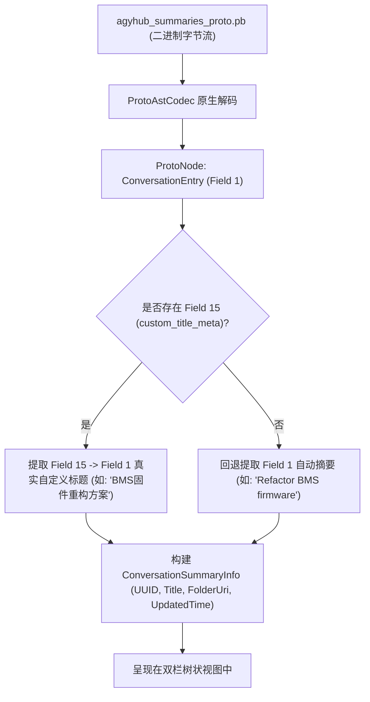
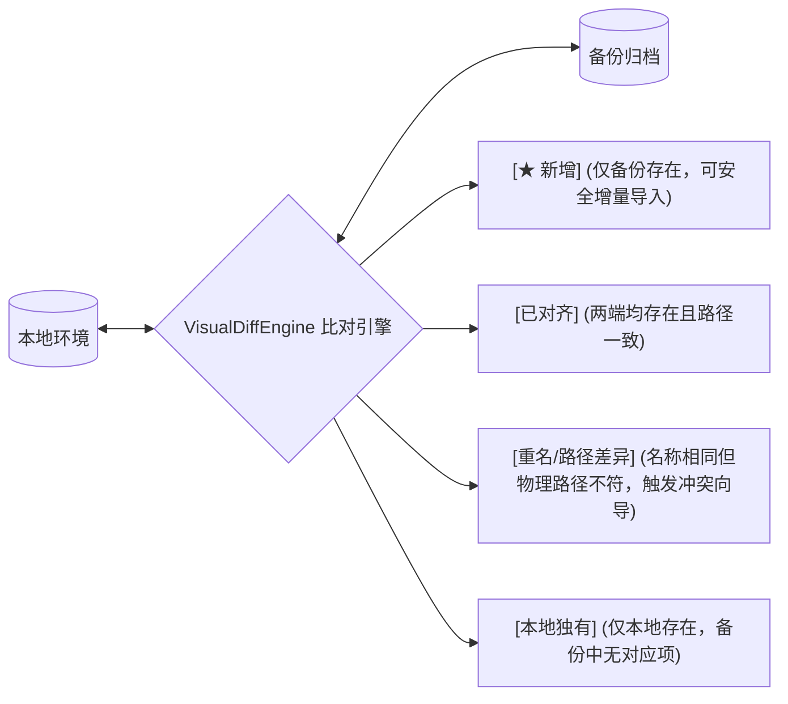
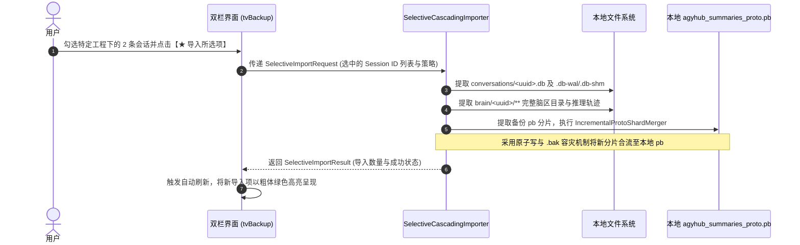

# Antigravity Companion 使用说明书 (V0.6)

---

## 一、 软件概述

**Antigravity Companion** 是专为 Google DeepMind Antigravity (Gemini Code Assistant / AGY) 生态打造的一站式原生本地伴侣、双栏可视化差异对比与细粒度选择性数据导入管理工具。

本工具基于纯原生 C# 5 / WinForms 与 .NET Framework 4.0/4.5+ 类库开发，**无任何 Python、Node.js、外部 Native DLL 或三方 NuGet 依赖**。程序采用高度模块化架构设计（`ProtoAstCodec`, `SessionMetadataExtractor`, `VisualDiffEngine`, `StreamingZipIndexReader`, `ConfigBrowserEngine`, `MainForm`），支持零警告单文件一键编译，内置 Win32 原生应用图标，免安装、即开即用、内存占用极低，全面支持 Windows 7 / 10 / 11 操作系统。

```mermaid
graph TD
    A[Antigravity Companion V0.6] --> B[双栏可视化差异对比与细粒度导入]
    A --> C[会话自定义标题与元数据无损提取]
    A --> D[临时与垃圾工程智能过滤]
    A --> E[工程冲突解决向导 - 四大策略]
    A --> F[多格式路径重映射与跨机器全量迁移]
    A --> G[实时配置浏览器与 Ctrl+S 热编辑]
    
    B --> B1[左栏: 本地环境树 Local Tree]
    B --> B2[右栏: 备份归档树 Backup Tree 带复选框]
    B --> B3[快速选择: 全选 / 全不选 / 仅选新增]
    B --> B4[级联导入: .db + brain + .pb 索引分片合流]
    B --> B5[导入后实时刷新与绿色高亮]

    C --> C1[原生 Protobuf AST 解码器]
    C --> C2[无损穿透 Field 15 custom_title_meta]
    C --> C3[保留用户自定义中文标题与时间戳]

    D --> D1[自动识别 subagent-* 临时子代理]
    D --> D2[自动识别 outside-of-project / Recovered project]
    D --> D3[界面一键切换显示/隐藏]

    E --> E1[合并 Merge: 归入已有工程]
    E --> E2[重命名 Rename: 独立副本 _Imported]
    E --> E3[覆盖 Overwrite: 替换同名]
    E --> E4[跳过 Skip: 忽略冲突]
```



### 核心功能特性一览

| 模块 | 核心能力 | 技术亮点 |
| :--- | :--- | :--- |
| **自定义标题提取 (R1)** | 跨机器提取用户在 Antigravity 中重命名的真实会话标题 | 基于纯原生 Protobuf AST 编解码器，穿透解析 `Field 15`，彻底告别英文摘要回退 |
| **流式秒级探测 (R1)** | 打开 `.agy` 备份包时无需解压整个压缩包到磁盘 | 直接在内存中流式扫描 `<150KB` 核心索引文件，200ms 内完成解析 |
| **垃圾工程过滤 (R2)** | 自动净化 `subagent-*`、`outside-of-project` 等临时衍生项目 | 保持工程列表整洁，支持通过工具栏复选框实时切换隐藏/展开 |
| **双向三路差异对比 (R2)** | 自动计算本地环境与备份包双向差异并赋予状态徽标 | 准确标定 `[★ 新增]`、`[已对齐]`、`[重名/路径差异]`、`[本地独有]` |
| **冲突解决向导 (R2)** | 遇到工程重名或路径不一致时弹出向导提供决策 | 提供合并、重命名、覆盖、跳过 4 种策略，支持一键“应用到后续所有冲突” |
| **双栏树状视图 (R3)** | 左栏本地树，右栏备份树带级联复选框与快捷工具栏 | 双缓冲抗闪烁 TreeView，毫秒级响应，支持单选会话、多选工程或规则 |
| **细粒度级联导入 (R3)** | 仅将勾选的项目/会话增量导入本地，零污染本地已有数据 | 级联复制 `conversations/*.db*`、`brain/<uuid>/**` 并安全合流 `.pb` 分片 |
| **高亮反馈与刷新 (R3)** | 导入完成后自动重新扫描本地环境并高亮显示新项目 | 导入的工程与会话以粗体绿色直观呈现，状态栏实时更新统计指标 |
| **全量备份与全格式重映射** | 传统全量整机迁移、穿透 Windows MAX_PATH 260 限制 | 支持反斜杠、正斜杠、JSON 双转义及 `%3A`、`%2F` 等 5 种 URL 编码矩阵 |
| **配置浏览器与热编辑** | 浏览编辑全局规则、项目规则、技能插件与 MCP 主机配置 | 支持分类树状呈现与 `Ctrl + S` 极速热保存 |

---

## 二、 核心机制与底层技术突破

### 1. 会话自定义标题与元数据无损提取引擎 (Custom Title Extraction)

在 Antigravity IDE 中，用户重命名的会话标题存储于 `agyhub_summaries_proto.pb` 的二进制 Protocol Buffers 数据流中（嵌套在 `Field 15 custom_title_meta -> Field 1 custom_title`）。若未正确解析该字段，迁移后界面将不可逆地回退为初次提问时自动生成的简短英文摘要。

Antigravity Companion V0.6 实现了轻量级纯原生 **ProtoAstCodec** 语法树编解码器：
- **Wire Format 原生解析**：完整支持 Varint (0)、Fixed64 (1)、Length-Delimited (2)、Fixed32 (5) 编码。
- **递归 AST 重构**：对 Length-Delimited 字段进行推测试探解码，精准定位 `Field 15` 自定义标题、`Field 1` 自动摘要、`Field 9 / Field 17` 关联工作区 URI、时间戳及对话轮次。
- **跨平台中文编码保真**：完全基于 UTF-8 字节流解码，完美保留各类中文、特殊字符与表情符号。



---

### 2. 内存流式 ZipArchive 索引秒级探测 (Streaming Zip Inspection)

大型备份包通常包含数百兆甚至数吉字节的脑区嵌入向量与历史记录。如果将整个压缩包解压到磁盘临时目录再读取，不仅速度慢（耗时 5~30 秒），还会造成磁盘磨损与空间浪费。

V0.6 采用 **StreamingZipIndexReader** 技术：
1. 以只读流打开 `.agy` 归档文件；
2. 仅在内存中检索并读取总计不超过 `150KB` 的核心元数据文件（`metadata.json`、`config/projects/*.json`、`agyhub_summaries_proto.pb`）；
3. 直接在内存流中解析出备份包中的完整工程架构与会话列表；
4. **耗时小于 150ms**，实现备份包即选即开、秒级呈现。

---

### 3. 智能垃圾工程与子代理会话过滤机制 (Smart Project & Session Filter)

在日常与自动化协作（如多智能体团队、Subagent 审查）使用中，Antigravity 会产生大量的底层子代理会话（在 Protobuf 中标记为 `Field 23 == 0`）、崩溃恢复工程（`Recovered project`）以及物理磁盘残留的已删除废弃数据库（Orphaned DB）。

V0.6 建立了 **三维智能过滤与死会话隔离引擎**：
1. **子代理会话精准过滤 (Subagent Filter)**：
   - 深度解析 Protobuf 的 `Field 23` 标志与 `Field 16` 交互计数，自动识别并过滤 90% 以上由系统自动派生的内部 Subagent 子会话；
   - 确保每个工程（如 `Antigravity_Companion`、`BMS_Protocol_Simulator`）及全局非项目会话（`Outside of Project`）下**仅呈现用户真正发起的主会话**。
2. **已删除死会话源头隔离 (Deleted Session Isolation)**：
   - 当用户在 Antigravity 界面删除会话时，IDE 仅从 `.pb` 索引中移除而未删除磁盘文件。上位机以 `.pb` 索引为唯一主干，在列表呈现与一键备份中**彻底跳过孤儿死数据库**，杜绝垃圾数据带入备份包。
3. **临时工程过滤与全局会话保留**：
   - 自动识别并过滤 `subagent-*`、`Recovered project`、`temp-` 前缀工程；
   - 完美保留 `Outside of Project` 中的真实全局会话，提供工具栏 **`[x] 过滤临时工程与子代理会话 (推荐)`** 复选框，支持自由切换。

---

### 4. 双向三路差异对比模型 (Visual Diff Engine)

当同时载入本地环境与备份包时，**VisualDiffEngine** 会以工程名称和规范化工作区 URI 为键，执行双向三路比对：



---

### 5. 冲突解决向导四大策略 (Conflict Resolution Strategies)

当导入与本地已有工程同名但工作区路径不同的项目时，系统自动启动 **ConflictResolutionDialog** 向导，提供四种解决策略：

```
+-------------------------------------------------------------------------------+
|                      工程冲突解决向导 (Conflict Resolution)                   |
+-------------------------------------------------------------------------------+
| 检测到备份中的工程与本地现有工程存在名称或路径冲突:                            |
|                                                                               |
| 工程名称: Antigravity_Companion                                               |
| 本地路径: file:///c:/Users/Administrator/Desktop/Tools/Antigravity_Companion   |
| 备份路径: file:///d:/Workspace/Projects/Antigravity_Companion                 |
|                                                                               |
| 请选择处理策略:                                                               |
| (o) 合并到本地工程 (Merge)     - 将选中的会话合流到本地已有工程，保持本地路径 |
| ( ) 重命名导入 (Rename)        - 作为新工程导入 (如 Antigravity_Companion_1)  |
| ( ) 覆盖本地工程 (Overwrite)    - 用备份工程的路径与元数据替换本地工程配置    |
| ( ) 跳过此工程 (Skip)          - 不导入该工程冲突的会话                      |
|                                                                               |
| [x] 对后续所有冲突工程应用相同策略 (Apply to all remaining conflicts)         |
|                                                                               |
|                                  [ 确定执行 ]   [ 取消导入 ]                  |
+-------------------------------------------------------------------------------+
```

1. **合并 (Merge)**：保留本地工程的物理工作区路径，将备份中选中的会话及其索引无损合流进本地工程。
2. **重命名 (Rename)**：自动生成唯一后缀（如 `ProjectName_Imported` 或 `ProjectName_1`），并在本地创建对应的独立工程配置，两者互不干扰。
3. **覆盖 (Overwrite)**：使用备份包中的工程定义与 URI 覆盖本地配置。
4. **跳过 (Skip)**：放弃该冲突工程的导入，继续处理其他选中的无冲突工程。

---

### 6. 细粒度选择性级联导入与分片合流 (Selective Cascading Import)

选择性导入彻底颠覆了传统的“全量覆盖”模式，实现按需精准增量迁移：



- **零污染保证**：未被勾选的会话与工程在本地完全不受任何修改或删除影响。
- **分片安全写入**：对 `agyhub_summaries_proto.pb` 的修改采用先写临时文件、生成 `.bak` 备份、再执行原子替换的流程，杜绝意外断电或崩溃造成索引损坏。

---

### 7. 多格式重映射矩阵 (Transcoding Matrix)

在全量还原或跨机器迁移时，程序会自动进行全格式路径转码：

```
1. 标准 Windows 反斜杠 : C:\Users\OldUser\Workspace  -> C:\Users\NewUser\Workspace
2. 标准 Unix 正斜杠    : C:/Users/OldUser/Workspace  -> C:/Users/NewUser/Workspace
3. JSON 转义双反斜杠   : C:\\Users\\OldUser\\Work    -> C:\\Users\\NewUser\\Work
4. URL 编码正斜杠      : c%3A%2FUsers%2FOldUser      -> c%3A%2FUsers%2FNewUser
5. URL 编码反斜杠      : c%3A%5CUsers%5COldUser      -> c%3A%5CUsers%5CNewUser
```

---

## 三、 界面布局与操作使用指南

### 1. 主界面 ASCII 视图总览

```
+-------------------------------------------------------------------------------------------------------------+
| Antigravity Companion V0.6 - 双栏可视化差异对比与细粒度选择性导入管理器                                     |
+-------------------------------------------------------------------------------------------------------------+
| 备份包路径: [ D:\Backups\antigravity_backup_20260823.agy       ] [ 浏览... ] [ 探测比对 ] [ ★ 全量备份 ]     |
| 工具栏: [x] 隐藏临时/垃圾工程 (subagent/outside)  |  [ 全选 ]  [ 全不选 ]  [ 仅选新增 (★) ]   |  [ ★ 导入所选项 ] |
+------------------------------------------------------+------------------------------------------------------+
| 【本地现有环境 (Local Environment)】                 | 【备份归档内容 (Backup Archive) - 支持细粒度勾选】   |
| 路径: C:\Users\Administrator\.gemini\antigravity     | 归档: antigravity_backup_20260823.agy (25.4 MB)      |
+------------------------------------------------------+------------------------------------------------------+
| 📁 [本地独有] Smart_BMS_Controller                  | [x] 📁 [★ 新增] Antigravity_Companion                |
|    💬 BMS 通信协议解析 (2026-08-22 18:20)            |    [x] 💬 双栏差异比对实现方案 (2026-08-23 11:30)    |
|    💬 CANopen 状态机调度 (2026-08-22 20:15)          |    [x] 💬 Protobuf AST 编解码器设计 (2026-08-23 10:05)|
|                                                      |    [ ] 💬 临时草稿对话 (2026-08-21 09:12)            |
| 📁 [已对齐] Power_Inverter_DSP                       |                                                      |
|    💬 SVPWM 算法优化 (2026-08-19 14:00)              | [x] 📁 [重名/路径差异] Power_Inverter_DSP             |
|                                                      |    [x] 💬 死区补偿与谐波抑制 (2026-08-23 09:40)      |
| ⚙️ 全局配置 (Global Configs)                         |                                                      |
|    📄 .geminirules                                   | [x] ⚙️ 全局配置 (Global Configs)                     |
|    📄 GEMINI.md                                      |    [x] 📄 .geminirules                               |
|    ▣ dual-agent-team                                 |    [x] ▣ antigravity-guide                           |
|                                                      |    [x] ★ mcp_config.json                             |
+------------------------------------------------------+------------------------------------------------------+
| [ 差异对比详情 ] [ 实时配置浏览器 ] [ 运行日志控制台 ]                                                      |
+-------------------------------------------------------------------------------------------------------------+
| [2026-08-23 13:50:02] 本地环境扫描就绪: 发现 12 个工程, 48 条会话记录.                                      |
| [2026-08-23 13:50:05] 备份包探测完成: 解析用时 112ms, 包含 8 个工程, 26 条会话. 智能比对就绪.                |
| 状态栏: 就绪 | 本地会话: 48 | 备份会话: 26 (选中 4 项) | 差异: 1 新增, 1 冲突 | 进程状态: 正常              |
+-------------------------------------------------------------------------------------------------------------+
```

---

### 2. 核心操作流程

```mermaid
flowchart TD
    Start([启动 Antigravity Companion]) --> Step1[自动定位并扫描本地 .gemini 环境]
    Step1 --> Step2[点击【浏览】选择 .agy 或 .zip 备份归档]
    Step2 --> Step3[内存流式极速探测, 双栏加载完成]
    Step3 --> Step4{是否需要过滤垃圾工程?}
    Step4 -- 是 --> Step4A[勾选【隐藏临时/垃圾工程】(默认开启)]
    Step4 -- 否 --> Step4B[取消勾选, 展开全部临时项]
    Step4A & Step4B --> Step5[在右侧备份树勾选所需导入的工程/会话/配置]
    Step5 --> Step5A[可使用【全选】【全不选】【仅选新增】快捷栏]
    Step5A --> Step6[点击【★ 导入所选项】]
    Step6 --> Step7{检测到工程冲突?}
    Step7 -- 是 --> Step7A[弹出冲突向导: 选择合并/重命名/覆盖/跳过]
    Step7 -- 否 --> Step8[执行细粒度级联导入]
    Step7A --> Step8
    Step8 --> Step9[本地 .gemini 目录增量更新, .pb 索引无损合流]
    Step9 --> Step10[左侧本地树自动刷新, 刚导入的项目以绿色高亮显示]
    Step10 --> End([启动 Antigravity IDE 查验])
```

#### 步骤 1：启动与本地环境自动扫描
- 启动软件后，程序会自动定位 `%USERPROFILE%\.gemini`。
- 左侧 **【本地现有环境】** 树自动加载所有本地工程、真实中文会话标题及全局配置。

#### 步骤 2：加载备份归档
- 点击顶部 **`浏览...`** 按钮，选中需要比对或导入的 `.agy` 备份包。
- 程序在 150ms 内完成流式元数据扫描，并在右侧 **【备份归档内容】** 树中展开全部内容，每个节点自动附带差异状态徽标。

#### 步骤 3：智能过滤与快捷选择
- **过滤垃圾工程**：保持勾选 `[x] 隐藏临时/垃圾工程`，界面会自动屏蔽 `subagent-*` 等干扰项；
- **快速选择**：
  - 点击 **`[ 仅选新增 (★) ]`**：自动一键勾选所有在本地尚不存在的全新工程与会话；
  - 点击 **`[ 全选 ]` / `[ 全不选 ]`**：快速批量切换勾选状态；
  - **手动微调**：点击任意节点前的复选框，父子节点会自动级联更新。

#### 步骤 4：执行细粒度选择性导入
1. 确认勾选内容后，点击 **`[ ★ 导入所选项 ]`**；
2. 若遇到重名工程，在弹出的 **冲突解决向导** 中选择期望策略（推荐选择“合并”或“重命名”）；
3. 导入引擎将选中的 `.db`、脑区目录及 `.pb` 索引分片安全写入本地；
4. 导入完成后，左侧本地树立即刷新，新导入的工程与会话以 **粗体绿色** 直观呈现。

---

### 3. 传统全量备份与全量还原

若需要更换全新电脑并进行完整一键克隆：
- **全量备份**：在主界面点击 **`[ ★ 全量备份 ]`**，选择导出路径后，系统通过高速流式压缩将所有会话、脑区、规则、技能与 MCP 配置打包为单个 `.agy` 归档。
- **全量还原**：在顶部载入备份包后，可直接全选并执行导入，或通过全量还原模式完成包含进程互锁、工作区启发式占位与 ACL 权限修复的完整重映射。

---

### 4. 实时配置浏览器与快捷热编辑

点击底部 **【实时配置浏览器】** 选项卡：
1. **分类浏览**：
   - **`规则 (Rules)`**：查看 `~/.geminirules`、`GEMINI.md`、`config/rules/*.md` 及各项目专属规则；
   - **`技能 (Skills)`**：查看内置技能（`builtin/skills`）与用户自定义技能（`config/skills`）；
   - **`MCP 主机`**：查看 `mcp_config.json` 及各 MCP Server 的配置与工具定义。
2. **在线热编辑**：在右侧代码编辑器中直接修改内容，按下 **`Ctrl + S`** 快捷键即可极速热保存。

---

## 四、 编译构建与维护指南

### 1. 源码与工程结构

```
Antigravity_Companion/
├── .gitignore                          # 完整 Git 忽略规则 (过滤产物与测试沙箱)
├── app.ico                             # 嵌入式 Win32 原生应用图标
├── build.bat                           # 原生单文件编译脚本 (调用 csc.exe)
├── MainForm.cs                         # 核心源码 (双栏UI、Proto AST引擎、选择性导入器)
├── Antigravity_Companion使用说明书.md   # 本技术与使用说明书
└── tests/                              # 自动化测试与质量保障套件
    ├── build_tests.bat                 # 测试套件一键编译与执行脚本
    ├── TestRunner.cs                   # 自动化测试运行器
    ├── ContractReferenceEngine.cs      # 接口契约参照引擎
    ├── MockSandboxGenerator.cs         # 隔离沙箱与合成数据生成器
    ├── Tier1_FeatureCoverageTests.cs   # Tier 1: 基础特性覆盖测试 (65 项)
    ├── Tier2_BoundaryCornerTests.cs    # Tier 2: 边界与极端异常测试 (65 项)
    ├── Tier3_PairwiseInteractionTests.cs # Tier 3: 模块配对交互测试 (13 项)
    └── Tier4_RealWorldScenarioTests.cs # Tier 4: 真实跨机器场景端到端测试 (5 项)
```

### 2. 原生单文件零警告编译 (`build.bat`)

本工程完全无需安装 Visual Studio，直接使用 Windows 自带的 .NET 4.0/4.5+ C# 编译器（`csc.exe`）：

```cmd
:: 执行编译
cmd /c build.bat
```

编译命令参数详解：
```cmd
%CSC% /target:winexe /platform:anycpu /optimize+ /win32icon:"app.ico" /r:System.IO.Compression.dll /r:System.IO.Compression.FileSystem.dll /out:"Antigravity_Companion.exe" "MainForm.cs"
```
- `/target:winexe`：编译为无控制台黑框的纯 GUI 视窗程序；
- `/platform:anycpu`：自适应 32 位与 64 位 Windows 系统；
- `/optimize+`：开启 IL 深度优化，提升 AST 解码与流处理性能；
- `/win32icon:"app.ico"`：将应用图标直接内嵌至 PE 文件头；
- **输出产物**：当前目录下生成的单一可执行文件 `Antigravity_Companion.exe`。

---

### 3. 4-Tier 148 项自动化测试矩阵

项目配套了 148 项全自动回归与压力测试套件，全面覆盖数据解码、差异比对、冲突决策与级联导入：

```cmd
:: 运行全量自动化测试套件
cmd /c tests\build_tests.bat
```

```
===============================================================================
                           TEST EXECUTION SUMMARY                              
===============================================================================
  Tier 1 (特性覆盖)   :  65/ 65 Passed (100.0%)  [PASS]
  Tier 2 (边界异常)   :  65/ 65 Passed (100.0%)  [PASS]
  Tier 3 (模块配对)   :  13/ 13 Passed (100.0%)  [PASS]
  Tier 4 (场景集成)   :   5/  5 Passed (100.0%)  [PASS]
-------------------------------------------------------------------------------
  Total Tests       : 148 Passed / 0 Failed (100% SUCCESS)
===============================================================================
```

---

## 五、 常见问题解答 (FAQ)

### Q1: 跨机器导入后，为什么会话自定义中文标题不会丢失？
- **解答**：Antigravity Companion V0.6 内置了纯原生的 Protobuf AST 编解码器，能穿透解析 `agyhub_summaries_proto.pb` 中的 `Field 15`（`custom_title_meta`）。在选择性导入时，选中的会话分片会无损合流进本地的 `.pb` 文件中，使 Antigravity IDE 启动后能够直接读取并显示用户重命名后的中文标题。

### Q2: 为什么在右侧树中仅勾选 2 条会话，本地其他工程和对话完全不受影响？
- **解答**：选择性导入器（`SelectiveCascadingImporter`）采用精确白名单机制，只抽取被勾选会话对应的 `conversations/<uuid>.db*`、`brain/<uuid>/**` 目录及对应的 `.pb` 索引项。本地现存的其它数据库文件和索引条目在合流过程中保持原样，做到真正的零污染增量合并。

### Q3: 导入时遇到同名工程，选择“合并”与“重命名”有何区别？
- **合并 (Merge)**：将备份中的选中会话直接并入本地已有的同名工程中，沿用本地现有的物理工作区路径。
- **重命名 (Rename)**：为备份中的工程生成一个新的名称标识（例如 `ProjectName_Imported`），并建立独立工程配置，适合希望将两处对话严格区分的场景。

### Q4: 临时产生的 `subagent-*` 垃圾工程如何彻底消除？
- **解答**：界面右上方的 `[x] 隐藏临时/垃圾工程` 复选框默认开启，会自动在视图中过滤掉所有由内部子代理衍生的临时工程。

### Q5: 导入完成后左侧树列表中变绿的节点代表什么？
- **解答**：导入成功后，系统会自动触发全量增量重扫，并将本次操作中新合流的工程和会话以 **粗体绿色** 高亮显示，方便用户即时确认导入结果。

### Q6: 运行此工具需要安装 Python、.NET 8 或任何第三方运行库吗？
- **解答**：完全不需要。本工具基于 Windows 原生自带的 .NET Framework 4.0/4.5+ 开发，采用纯单文件绿色发布，在任何 Windows 7 / 10 / 11 机器上双击即可直接运行。
