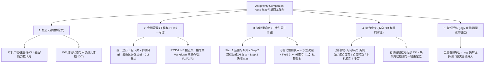

# Antigravity Companion 使用说明书 (V0.8)

---

## 一、 软件概述

**Antigravity Companion V0.8** 是专为 Google DeepMind Antigravity (AGY) 生态打造的现代桌面工作台，集**环境概览体检、工程与 CLI 会话管理、三步式智能重命名、双向能力仓库 Diff 同步与 .agy 备份迁移**于一体。

本工具基于纯原生 C# 5 / .NET Framework 4.8+ 与零外部 CDN 离线单页前端开发，编译为**单个独立可执行文件 `Antigravity_Companion.exe`**：启动后自动在纯用户态回环端口（`127.0.0.1` 动态端口，无需管理员权限或 UAC）启动内嵌 HTTP/1.1 + SSE 服务，并通过 Edge `--app`（回退 Chrome `--app` 或默认浏览器）以原生桌面应用形态运行；同时保留 `--legacy-ui` 命令行参数用于回退旧版 WinForms 双栏界面。



### V0.8 核心升级亮点

| 模块 / 特性 | 核心能力 | 技术实现与安全边界 |
| :--- | :--- | :--- |
| **零依赖单文件桌面工作台** | 5 模块左侧固定导航（概览 / 会话管理 / 智能重命名 / 能力仓库 / 备份迁移）+ 浅灰默认 / 深色模式切换 + 28px 底部可折叠实时日志条 | `LocalWebHost`（纯用户态 `TcpListener` + SSE 推送 + 严格 `Host`/`Origin`/`SameSite=Strict`/CSP 无内联脚本防护）+ `NativeDialogBridge` 原生文件与目录弹窗 |
| **工程归属修复与路径降噪** | 彻底修复二进制 `Field 17->1` 子消息与 `folderUris` 多根目录引起的工程丢失/分裂；支持 `antigravity-cli` 会话完整首问与 Markdown 预览 | `ProtoCodec.IsValidCascadeContainer` 与 `IsSafeDisplayProjectName` 防乱码穿透；同 basename 工程自动剥离共同前缀，展示最短区分父目录段 |
| **三步式智能重命名 & 规则工作台** | 自动匹配 `Field 9->4` Git 分支与机型关键字、剥离尾缀 `"分支"`、折叠标题中/尾部元数据 `【标签】` 避免双重括号，默认取消勾选 0 步/通用水词会话 | 抽屉式 **可视化规则表单** 与 **沙盒试跑** 实时调优 `Repository/rename_rules.json`；**两步 AI 润色助手** 支持剪贴板与 JSON 文件双向交换；快照行级精准回滚 |
| **方向感能力 Diff 矩阵** | 明确给出同步建议（`两侧一致` / `仅仓库有（可导入）` / `仅本机有（可入库）` / `仓库较新` / `本机较新` / `双方均有修改`） | 优先对比三层基线签名，缺失基线时回退统一 UTC 文件修改时间（含 ZIP 时间 UTC 校准）；抽屉支持受控有界行级红绿 LCS Diff 与 `{{HOME}}` 路径重定位 |
| **安全进程门禁与只读 GC** | 只读孤儿体检即使在 IDE 运行锁定 `.pb` 时仍可安全执行；写入前自动检测运行中 IDE 并引导关闭或安全热写入 | `ReadAllBytesShared` / `ReadUtf8TextShared` 共享只读读取；清理与全量写前二次扫描防 TOCTOU；保留 `--legacy-ui` 兼容开关 |

---

## 二、 五大模块操作指南

### 1. 概览（启动默认页）
- **状态总览**：直观查看正式工程数、主会话数、CLI 会话数、本机与仓库能力对齐情况，以及可释放空间大小。
- **IDE 运行门禁**：右上角实时展示 Antigravity IDE 主进程与语言服务数量；可一键触发只读孤儿体检、安全清理孤儿垃圾或直达智能重命名/能力同步入口。

### 2. 会话管理
- **左栏统一工程导航**：每个工程固定展示 2 行（工程名称 + 会话总数；物理路径按 `~` / `多目录 · N 个根目录` / 同名最短区分父目录折叠）。底部辅助分组集中收纳 `CLI 命令行会话`、`Outside of Project`、`子任务` 与临时对话。
- **三层读取与搜正文**：自动按 **Layer 1 `.pbtxt` > Layer 2 `conversation_summaries.db` > Layer 3 `.pb`** 叠加标题；开启 **「搜正文」** 后通过 FTS5 `MATCH` 与安全转义 `LIKE` 检索完整对话文本。
- **抽屉式 Markdown 预览与导出**：点击任意会话右侧 **「预览」** 在右侧抽屉渲染结构化 Markdown（已清理 `<ADDITIONAL_METADATA>` 噪音，兼容 CLI 会话脑区日志），支持一键复制或 **「导出为 .md」**；支持多选执行 **「迁移工程」**、**「导出 .agy」**、**「级联删除」** 及工程路径 **「重定位」**。

### 3. 智能重命名（三步引导）
1. **Step 1：范围筛选 & 规则调节**：支持按正式工程范围筛选，开关 **「已有【】前缀」**、**「0 步 / 通用水词」**、**「运行中」** 会话；点击 **「规则编辑器」** 打开可视化表单调节工程别名、多仓机型关键字与分支正则，支持 **「▶ 沙盒试跑规则」** 与源码 JSON 切换。
2. **Step 2：双栏预览、手工微调与 AI 润色**：左侧勾选清单（默认不选 0 步/通用水词、已标前缀或运行中会话），右侧实时查看首问全文、提取分支与单行新标题编辑；点击 **「AI 润色」** 可选剪贴板协同或 `.txt` / JSON 文件往返批处理。
3. **Step 3：确认并三层持久化写入**：点击执行后自动生成 `companion_rename_backups` 三层快照并写入 `.pbtxt` / `.db` / `.pb`；随时点击 **「⏪ 回滚历史」** 按批次恢复。

### 4. 能力仓库 (`Repository/`)
- **分类筛选与同步建议**：按 `Plugin` / `Skill` / `Rule` / `MCP` / `Hook` 或同步方向筛选（`仅需处理` 快速定位未对齐项）。
- **行级源码 Diff 抽屉**：点击 **「对比差异」** 查看具体 JSON 注册片段及文件逐行红绿 Diff，并在抽屉底栏直接执行 **「← 采纳仓库版到本地」** 或 **「推入内置仓库 →」**。
- **脚本路径体检与重定位**：存在本机缺失脚本或可执行路径的 MCP / Hook 条目带黄色预警徽标，支持展开内联更换本地路径（支持原生文件选择框）。

### 5. 备份迁移 (`.agy`)
- **全量备份与选择性打包**：一键后台流式创建全量 `.agy` 归档（经 SSE 实时更新顶部进度提示），或在会话管理中按勾选导出轻量包。
- **免解压流式导入**：打开外部 `.agy` 后，自动比对归档与本机的能力差异（支持红绿 Diff 查看）及各工程/会话新增状态，一键按 Key 级合流与路径重映射导入。

---

## 三、 启动参数与源码测试说明

### 1. 命令行参数（可选）

| 参数 | 说明 |
| :--- | :--- |
| `--legacy-ui` | 强制启动传统 WinForms 双栏界面（V0.8 保留兼容回退） |
| `--no-browser` | 仅启动本地工作台 HTTP 服务并输出访问 URL，不自动拉起浏览器窗口 |
| `--port <port>` | 指定回环监听端口（默认自动分配空闲端口 `0`） |
| `--home <dir>` | 指定隔离测试或自定义用户主目录 |
| `--repo <dir>` | 指定自定义能力仓库 `Repository` 目录 |
| `--token <token>` | 指定固定访问会话令牌（默认每次启动通过 `RNGCryptoServiceProvider` 生成 32 字节随机令牌） |

### 2. 源码目录结构

```text
Antigravity_Companion/
├── AppServices.cs                    # 进程门禁、工作区聚合分组、备份传输调度与 STA 原生弹窗桥
├── LocalWebHost.cs                   # 纯用户态 TcpListener HTTP/1.1 + SSE 服务、CSP 与 REST API
├── WebShellLauncher.cs               # Edge/Chrome --app 独立桌面壳拉起与空闲生命周期托管
├── ui/
│   ├── index.html                    # 零外部依赖离线 SPA 骨架
│   ├── styles.css                    # Slate Light (默认) / Dark 主题与极简排版样式系统
│   └── app.js                        # 5 模块交互状态机、SSE 订阅、抽屉 Diff/Markdown/规则编辑器
├── ProtoAstCodec.cs                  # 原生 Protobuf AST、Field 17/9 提取与 SQLite/FTS5 桥接
├── SessionMetadataExtractor.cs       # 三层元数据叠加、多根目录匹配与 antigravity-cli 首问提取
├── SessionRenameEngine.cs            # .pbtxt 编解码、规则合成、标签吸收、沙盒试跑、回滚与 AI 交换
├── StreamingZipIndexReader.cs        # 流式 Zip 索引、多格式路径重映射与 folderUris 数组扫描
├── VisualDiffEngine.cs               # 方向感知能力 Diff (三方基线 + UTC 时间) 与有界 LCS 行级 Diff
├── LocalWorkspaceManager.cs          # 本地三层原子写入、级联删除与共享读锁只读孤儿 GC
├── CapabilityRepositoryManager.cs    # 能力扫描、{{HOME}} 跨机泛化、键值级合流与同步基线持久化
├── TranscriptMarkdownExporter.cs     # 会话流与 CLI 脑区日志 Markdown 有界预览与完整导出
├── MainForm.cs                       # 程序入口路由、命令行解析与 --legacy-ui WinForms 界面
├── build.bat                         # 编译单文件 Antigravity_Companion.exe（内嵌 ui/* 资源）
├── Repository/                       # 明文能力仓库与重命名规则 rename_rules.json
└── tests/
    ├── build_tests.bat               # 编译并运行生产代码端到端验证套件
    └── TestRunner.cs                 # 核心引擎与 HTTP 工作台全量测试套件 (T01 - T42)
```

### 3. 编译构建与自动化验证 (`T01` ~ `T42`)

```cmd
:: 1. 编译单文件可执行程序 Antigravity_Companion.exe
cmd /c build.bat

:: 2. 编译并运行 42 项生产代码自动化验证套件
cmd /c tests\build_tests.bat
```

- **T01 ~ T36**：覆盖 Protobuf AST、三层标题同步、`winsqlite3.dll` FTS5/LIKE、`rename_rules.json` 规则合成、行级快照回滚、AI 剪贴板往返、五类能力 Key 级合流、`ZipSlip` 防御与共享读锁校验。
- **T37**：验证 `Field 17->1` 二进制子消息防乱码保护、SQLite `ProjectId` 回填及 `folderUris` 多根目录归属匹配。
- **T38**：验证 `Field 9->4` 多仓库分支筛选、尾缀 `"分支"` 剥离、`PayGo 【标签】` 折叠防双括号、正文强调保护及 0 步低价值识别。
- **T39**：验证 `antigravity-cli/brain` 首问与 Markdown 导出回退、最短区分父目录计算及辅助分组隔离。
- **T40**：验证三方基线/UTC 时间双向 Diff、有界 LCS 行级 Diff 截断护栏与 `.pb` 共享锁定状态下的只读 GC。
- **T41**：验证纯用户态 `LocalWebHost` 动态端口、防 DNS 重绑定（`Host`）、CSRF `Origin`、`SameSite=Strict` Cookie 重载、CSP 头、UTF-8 中文 `Content-Length` 精确分帧及只读 API。
- **T42**：验证隔离沙盒端到端 HTTP 闭环（执行重命名 -> 快照历史 -> 回滚、AI 提示词导出与 JSON 文件回填、能力入库/刷新/本地导入、GC 体检与 `.agy` 归档探测）。
