# Antigravity Companion 使用说明书 (V0.6)

---

## 一、 软件概述

**Antigravity Companion** 是专为 Google DeepMind Antigravity (AGY) 生态打造的原生双栏可视化差异对比、本地工作区深度治理与细粒度数据迁移工具。

本工具基于纯原生 C# 5 / WinForms 与 .NET Framework 4.0/4.5+ 类库开发，**无任何外部依赖**。程序采用精简模块化架构（`ProtoAstCodec`、`SessionMetadataExtractor`、`VisualDiffEngine`、`StreamingZipIndexReader`、`LocalWorkspaceManager`、`TranscriptMarkdownExporter`、`MainForm`），支持单文件一键编译，免安装、即开即用。

```mermaid
graph TD
    A["Antigravity Companion V0.6"] --> B["双栏可视化差异对比与细粒度导入"]
    A --> C["会话元数据提取与自定义标题穿透"]
    A --> D["临时与子代理会话智能过滤"]
    A --> E["跨机全格式路径重映射与无损合流"]
    A --> F["本地工作区深度治理引擎 (F1 & F2)"]
    A --> G["细粒度轻量备份与文档导出引擎 (F3 & F4)"]
    
    B --> B1["左栏: 本地环境工程树 (Local Tree 级联复选)"]
    B --> B2["右栏: 备份归档工程树 (Backup Tree 级联复选)"]
    B --> B3["差异徽标: 新增 / 已修改 / 已对齐 / 本地独有"]
    B --> B4["细粒度导入: .db + brain + .pb 索引分片合流"]

    C --> C1["原生 Protobuf AST 编解码器"]
    C --> C2["无损穿透 Field 15 custom_title_meta"]

    D --> D1["精准识别 Field 23 子代理会话与 subagent-* 临时工程"]
    D --> D2["工具栏实时切换显示/隐藏"]

    E --> E1["同名工程自动锁定本地路径静默增量合流"]
    E --> E2["6 种路径编码大小写不敏感重映射"]

    F --> F1["F1: 级联物理删除 (会话/整工程/隐藏子代理) 与孤儿 GC"]
    F --> F2["F2: 会话重命名 (双向固化) / 跨工程迁移 / 路径重定向"]

    G --> G1["F3: 选择性轻量备份导出 (.agy 裁剪分片)"]
    G --> G2["F4: 会话对话流与 Artifacts 导出为 Markdown (.md 免导入流式提取)"]
```



### 核心功能特性一览

| 模块 / 特性 | 核心能力 | 技术实现与处理边界 |
| :--- | :--- | :--- |
| **自定义标题提取** | 跨机器提取用户在 Antigravity 中重命名的真实会话标题 | 基于纯原生 Protobuf AST 编解码器，穿透解析 `Field 15` |
| **流式秒级探测** | 打开 `.agy` 备份包时无需解压整个压缩包到磁盘 | 直接在内存中流式扫描核心索引文件，毫秒级完成解析 |
| **子代理与垃圾过滤** | 自动净化 `subagent-*`、`Recovered project` 及子代理衍生会话 | 解析 `Field 23` 与 `Field 16` 标志位，支持工具栏实时切换 |
| **双向差异对比** | 自动计算本地环境与备份包差异并赋予状态徽标 | 标定 `[新增]`、`[已修改/更新]`、`[已对齐]`、`[本地独有]` |
| **静默跨机合流** | 遇到同名跨盘符/跨用户工程时自动锁定本地有效路径合流 | 自动将备份会话及 SQLite 轨迹元数据重映射至本地工程路径 |
| **细粒度级联导入** | 仅将勾选的项目/会话及可选全局配置增量导入本地 | 级联提取 `conversations/*.db*`、`brain/<uuid>/**` 并合流 `.pb` 分片 |
| **F1：级联物理删除与孤儿 GC** | 支持按单会话、多选或整工程（含 `Administrator` 等幽灵工程）彻底物理删除；一键扫描脱离索引的孤儿残留并回收空间 | 级联清除隐藏的 Subagent 会话，原子重写 `agyhub_summaries_proto.pb`（自动备份 `.bak`），物理删除 `.db*`、`brain/` 与 `config/projects/<id>.json`；扫描比对 Proto 索引回收脱离索引的残余文件并统计释放的 MB 空间 |
| **F2：会话重命名与工程治理** | 支持会话原地重命名；支持将散落会话跨工程批量迁移绑定；支持重定向工程物理路径与修复工程注册 | 双向持久化固化 `Field 1` 与 `Field 15` 杜绝重启回退；原子更新 `.pb` `Field 9/17` 与底层 SQLite `trajectory_metadata_blob`；自动同步更新 `config/projects/*.json` |
| **F3：选择性轻量备份导出** | 本地树级联勾选指定工程或单条会话，导出为轻量级 `.agy` 归档包 | 自动裁剪生成仅含所选会话分片的 `agyhub_summaries_proto.pb`，精准打包关联的 `.db`、`brain/` 与工程配置，可选包含全局规则/技能/MCP |
| **F4：Markdown 对话记录导出** | 将会话明文对话记录与脑区产出文档导出为排版整洁的独立 `.md` 文件；**支持直接从右栏备份包免导入流式提取** | 解析 `transcript.jsonl` 并剥离 `<ADDITIONAL_METADATA>` 系统噪音；思考推理过程封装为 `<details>` 折叠块；无缝追加整合 `brain/<uuid>/*.md` 产出文档 |

---

## 二、 核心操作流程

### 1. 跨机备份与差异导入工作流

1. **启动与本地探测**：启动软件后自动定位 `%USERPROFILE%\.gemini`，左栏加载本地工程与真实会话标题。
2. **加载备份归档**：点击顶部 **「打开备份包...」** 选择 `.agy` 或 `.zip` 备份包，右栏秒级展开备份内容并自动勾选所有 `[新增]` 与 `[已修改/更新]` 的主会话。
3. **过滤与微调勾选**：
   - 保持勾选 **`[x] 过滤临时工程与子代理会话`** 屏蔽内部子任务噪音；
   - 如需同步迁移全局规则、自定义技能/插件与 MCP 配置，勾选 **`[ ] 同步导入全局配置`**；
   - 使用右栏顶部 **「仅选新增/更新」**、**「全选」**、**「全不选」** 或手动勾选特定会话。
4. **执行细粒度导入**：点击顶部 **「导入所选项到本地」**，程序自动合流选中会话、重写跨机工作区路径并刷新左栏（新导入项以粗体绿色高亮显示）。
5. **全量备份导出**：点击顶部 **「全量备份导出...」**，程序按白名单将有效主会话、脑区目录、`.pb` 索引、项目配置及用户规则/技能/MCP 打包为 `.agy` 归档（自动排除已删除孤儿数据库、IDE 内置 `builtin/skills` 与本机 `installation_id`）。

### 2. 本地工作区治理指南 (F1 ~ F4 新增特性)

#### F1: 会话/工程级联物理删除与孤儿垃圾清理 (GC)
- **彻底物理删除会话或整工程**：
  1. 在左栏「本地环境」树中，勾选要删除的会话或整工程（若未勾选任何复选框，则自动作用于当前鼠标点击选中的节点）；
  2. 点击左栏头部操作区的 **「删除所选」** 按钮、按键盘 **`Delete`** 键，或右键选择 **「彻底删除所选工程/会话 (Delete)...」**；
  3. 弹窗确认待删除清单（包含所选主会话下关联的所有隐藏 Subagent 子会话及工程名称）；
  4. 确认后程序自动关闭 Antigravity 写入锁，从 `agyhub_summaries_proto.pb` 中移除节点（自动生成 `.bak` 安全备份），彻底物理删除磁盘上的 `conversations/<uuid>.db*`、`brain/<uuid>/` 与工程配置文件 `config/projects/<id>.json`，支持彻底清除 IDE 内部不可见的幽灵工程（如 `Administrator`、`InvertProject`）。
- **孤儿垃圾清理 (GC)**：
  1. 点击左栏头部操作区的 **「清理孤儿垃圾」** 按钮，或在左栏右键选择 **「扫描并清理孤儿数据库与脑区 (GC)...」**；
  2. 程序自动扫描磁盘上的所有 `.db` 与 `brain/` 目录，并与当前 `agyhub_summaries_proto.pb` 活跃索引进行反向比对；
  3. 发现脱离索引的残留孤儿文件时，弹窗提示孤儿会话数量与可释放的 MB 磁盘空间；
  4. 点击确认即可一键物理清除所有孤儿残留。

#### F2: 会话重命名、跨工程迁移与工程路径重定向
- **本地会话原地重命名**：
  1. 在左栏选中任意会话节点；
  2. 按键盘 **`F2`** 键，或右键选择 **「重命名此会话 (F2)...」**；
  3. 在输入框中输入新的自定义标题并确认；
  4. 程序将新标题同步固化至 Protobuf 索引的 `Field 1`（主标题）与 `Field 15`（用户自定义标题元数据），确保 IDE 再次读取或刷新时标题不丢失、不退化。
- **会话跨工程迁移与归属绑定**：
  1. 在左栏勾选或选中一条或多条需要调整归属的会话（例如散落在 `Outside of Project` 或 `Administrator` 下的零散会话）；
  2. 右键选择 **「移动所选会话到其他工程...」**；
  3. 在对话框中选择现有工程，或输入新建工程名称与本地工作区物理路径；
  4. 确认后程序原子级更新 `agyhub_summaries_proto.pb` 中的 `Field 9` 与 `Field 17`，并同步更新底层 SQLite 数据库的 `trajectory_metadata_blob`，完成会话与物理工作区的无缝绑定。
- **工程物理路径重定向与注册修复**：
  1. 在左栏选中目标工程节点（或其下任意会话）；
  2. 右键选择 **「重定向此工程本地路径 / 修复工程注册...」**；
  3. 在文件夹选取框中指定新的本地工作区路径；
  4. 确认后程序自动修复/创建 `config/projects/<id>.json` 配置文件，并同步将该工程下所有关联会话的 `.pb` 索引与 SQLite 路径重定向至新目录。

#### F3: 选择性轻量备份导出 (`.agy`)
1. 在左栏「本地环境」树中，勾选需要分享或归档的特定工程或单条会话（支持级联半选/全选）；
2. 点击左栏头部操作区的 **「导出所选(.agy)」** 按钮，或在左栏右键选择 **「导出所选工程/会话为轻量备份包 (.agy)...」**；
3. 弹窗提示是否同时附带全局规则、插件与 MCP 配置（点击「是」包含全局配置，点击「否」仅导出纯净会话）；
4. 选择保存路径，程序自动裁剪生成仅包含所选会话分片的 `agyhub_summaries_proto.pb` 索引，并将关联的 `.db` 数据库、`brain/` 目录与工程配置打包为轻量级 `.agy` 文件。

#### F4: 会话对话记录与 Artifacts 导出为 Markdown (`.md`)
- **本地会话导出**：
  1. 在左栏选中任意会话节点；
  2. 右键选择 **「导出此会话对话记录为 Markdown (.md)...」** 并指定保存路径；
  3. 程序将 `transcript.jsonl` 中的对话流与脑区产出物无缝组装为标准化 `.md` 文件。
- **备份包免导入流式提取**：
  1. 打开任意 `.agy` 或 `.zip` 备份归档；
  2. 在右栏「备份归档」树中选中任意感兴趣的备份会话；
  3. 右键选择 **「直接预览/导出此备份会话为 Markdown (.md) [免导入]...」**；
  4. 无需将备份数据导入本地环境，程序直接在内存中流式解构提取该会话的对话记录与脑区交付件并保存为 `.md`。
- **Markdown 排版特性**：
  - **提问降噪**：自动剥离提示词中的 `<ADDITIONAL_METADATA>` 系统注入标签，还原纯净用户指令；
  - **思考过程折叠**：将 AI 内部思维链渲染为 GitHub 风格的 `<details><summary>思考过程 (Thinking Process)</summary>...</details>` 折叠区块；
  - **交付件整合**：自动扫描并提取 `brain/<uuid>/*.md` 生成的所有架构文档与代码交付件，平铺追加在对话流末尾。

### 3. 操作入口与快捷键速查表

| 操作入口 / 快捷键 | 作用区域 | 功能说明 |
| :--- | :--- | :--- |
| **`F2`** / 右键菜单 | 左栏会话节点 | 重命名本地会话（双向固化 Field 1 与 Field 15） |
| **`Delete`** / **「删除所选」** | 左栏工程或会话节点 | 级联物理删除所选工程/会话（含 Subagent、.db、brain/、project.json） |
| **「清理孤儿垃圾」** / 右键菜单 | 左栏顶部栏 / 右键菜单 | 扫描比对脱离 .pb 索引的孤儿残留数据库与脑区并一键 GC 清理 |
| **「导出所选(.agy)」** / 右键菜单 | 左栏顶部栏 / 右键菜单 | 细粒度选择性轻量备份导出（裁剪 Proto 索引分片） |
| 右键 **「移动所选会话到其他工程...」** | 左栏会话节点 | 批量重绑定会话归属（修复 Outside of Project / 幽灵工程） |
| 右键 **「重定向此工程本地路径...」** | 左栏工程节点 | 重定向工作区物理文件夹并修复 config/projects 注册 |
| 右键 **「导出此会话对话记录为 Markdown...」** | 左栏会话节点 | 导出本地会话对话流明文与 brain/*.md 产出文档 |
| 右键 **「直接预览/导出...[免导入]」** | 右栏备份会话节点 | 免导入流式提取备份包中指定会话为 Markdown 文档 |
| **「仅选新增/更新」** / **「全选」** / **「全不选」** | 右栏顶部栏 | 快速调整备份包导入勾选项 |

---

## 三、 编译构建与自动化验证

### 1. 源码结构

```
Antigravity_Companion/
├── .gitignore                          # Git 忽略规则
├── app.ico                             # 嵌入式 Win32 原生应用图标
├── build.bat                           # 原生单文件编译脚本 (csc.exe)
├── ProtoAstCodec.cs                    # 原生 Protobuf AST 编解码器、分片合流与 SQLite 重映射
├── SessionMetadataExtractor.cs         # 会话元数据提取器与临时工程/子代理过滤器
├── StreamingZipIndexReader.cs          # 流式 Zip 索引读取器与多格式路径重映射工具
├── VisualDiffEngine.cs                 # 双栏工程与会话差异比对引擎
├── LocalWorkspaceManager.cs            # 本地工作区治理引擎 (F1 级联物理删除与孤儿 GC、F2 会话重命名/跨工程迁移/工程路径重定向、F3 选择性轻量备份导出)
├── TranscriptMarkdownExporter.cs       # 会话明文对话记录 (transcript.jsonl) 与脑区产出文档 (brain/<uuid>/*.md) 的 Markdown 导出引擎 (F4)
├── MainForm.cs                         # WinForms 双栏主界面与全套治理/备份/导入工作流
└── tests/                              # 生产代码直连自动化测试套件
    ├── build_tests.bat                 # 编译真实生产源码并执行回归测试
    └── TestRunner.cs                   # 核心引擎端到端验证用例 (T01 - T14)
```

### 2. 编译与测试命令

```cmd
:: 1. 编译单文件可执行程序 Antigravity_Companion.exe
cmd /c build.bat

:: 2. 编译并运行生产代码自动化验证套件 (覆盖 T01 - T14 全量用例)
cmd /c tests\build_tests.bat
```

### 3. 自动化测试套件用例覆盖矩阵 (T01 ~ T14)

| 用例编号 | 覆盖模块与功能点 | 验证目标 |
| :--- | :--- | :--- |
| **T01** | `ProtoAstCodec` | Protobuf 变长整数 (Varint) 编解码边界与 AST 结构往返保真度 |
| **T02** | `SessionMetadataExtractor` | 真实 Proto 结构中 `Field 15` 用户自定义重命名标题无损穿透 |
| **T03** | `SessionMetadataExtractor` | 非法扁平条目剔除与深层嵌套有效会话精准识别 |
| **T04** | `SmartProjectFilter` | `subagent-*`、`Recovered project` 与子代理衍生会话过滤隔离 |
| **T05** | `StreamingZipIndexReader` | `.agy` 归档免解压流式内存探测与毫秒级索引解析 |
| **T06** | `VisualDiffEngine` | 双栏工程/会话状态差异计算与跨盘符同名工程智能合流 |
| **T07** | `IncrementalProtoShardMerger`| 增量 Protobuf 索引分片无损追加合流与 URI 动态重映射 |
| **T08** | `DirectStreamArchiver` | 6 种跨机工作区路径编码大小写不敏感重映射 |
| **T09** | `LocalWorkspaceManager (F1)` | 级联物理删除会话/整工程、同步清理隐藏 Subagent 与 `.pb` 节点剔除 |
| **T10** | `LocalWorkspaceManager (F1)` | 孤儿垃圾收集器 (GC) 反向比对扫描脱离索引的数据库与脑区并清理 |
| **T11** | `LocalWorkspaceManager (F2)` | 会话重命名及 `Field 1` 与 `Field 15` 双向持久化固化验证 |
| **T12** | `LocalWorkspaceManager (F2)` | 会话跨工程迁移与工程本地物理工作区路径重定向 |
| **T13** | `LocalWorkspaceManager (F3)` | 细粒度选择性轻量备份导出、Proto 裁剪分片与往返解包验证 |
| **T14** | `TranscriptMarkdownExporter (F4)`| 对话流 JSONL 解析、提示词降噪、思考过程折叠与免导入流式 Markdown 提取 |
