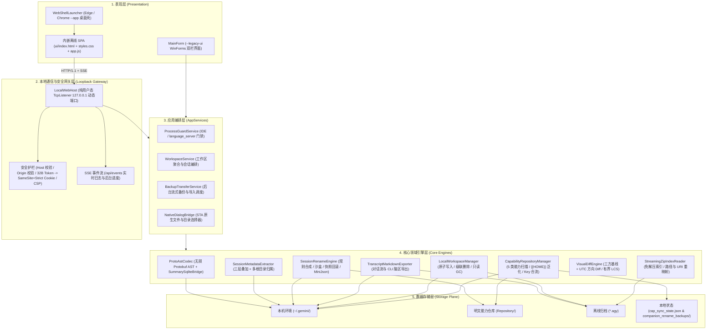

# Antigravity Companion (V0.8)

**面向 Windows 平台 Google Antigravity (AGY) 生态的本地单文件运维与资产治理工作台**（Local Control Plane & Migration Workbench）。

`Antigravity_Companion` 是 Antigravity IDE / CLI 的伴生桌面管理工具。它直接治理本机 `~/.gemini/` 下的会话、工程与五类扩展能力资产，用于解决三类高频问题：**会话标题与工程归属混乱**、**扩展能力分散且难以跨机同步**、**跨设备离线备份与路径重映射迁移**。

| 维度 | 当前实现 |
| :--- | :--- |
| **交付形态** | 纯原生 C# 5.0（.NET Framework 4.5+）+ 内嵌离线 SPA（`ui/*`），单文件编译为 `Antigravity_Companion.exe` |
| **运行方式** | 纯用户态 `127.0.0.1` 动态回环端口 HTTP/1.1 + SSE 服务，默认拉起 Edge / Chrome `--app` 独立桌面窗口（无 UAC 提权） |
| **兼容回退** | 支持回退系统默认浏览器，或通过 `--legacy-ui` 切换传统 WinForms 双栏界面 |
| **数据底座** | 无损 Protobuf AST 编解码、`winsqlite3.dll` P/Invoke（FTS5 / WAL）、流式 ZIP（`.agy`）、JSON Key 级局部合流 |
| **详细操作手册** | 见 [Antigravity_Companion使用说明书.md](./Antigravity_Companion使用说明书.md) |

---

## 一、 项目定位

在长期使用 Antigravity IDE 与 `antigravity-cli` 后，本机 `~/.gemini/` 会持续积累大量分散资产：

1. **会话与工程元数据分散在三层存储中**：`.pbtxt` 标注、SQLite 摘要库、Protobuf 二进制索引容易不同步，且存在临时沙盒、子代理会话与孤儿残留文件。
2. **自定义能力跨文件耦合**：Plugin、Skill、Rule、MCP Server、Hook 分别散落在目录与多份 JSON 注册表中，且常硬编码本机用户目录路径。
3. **跨机器迁移成本高**：直接复制目录会触发绝对路径、`file:///` URI 编码、SQLite 元数据与工程配置失效。

**Antigravity Companion** 的定位是位于 Antigravity 运行时之外的**本地治理与迁移中枢**——以零外部运行时依赖、可控可回滚的原子写入方式，统一提供环境体检、会话治理、智能重命名、能力仓库双向 Diff 同步与 `.agy` 流式迁移能力。

---

## 二、 能力边界（做什么 / 不做什么）

### ✅ 边界内（当前具备的核心能力）

| 能力域 | 具体能力 | 关键约束与安全护栏 |
| :--- | :--- | :--- |
| **1. 环境体检与安全孤儿 GC** | 实时探测 Antigravity IDE 与 `language_server` 进程；只读扫描孤儿 `.db`、脑区目录与 `.pbtxt` 标注并一键清理 | 共享读锁（`ReadWrite \| Delete`）免打断读取；缺失或异常索引时 fail-closed 中止扫描；清理前二次核验防 TOCTOU |
| **2. 工程与会话生命周期治理** | 三层元数据叠加展示；多根目录 `folderUris` 与同名工程最短区分父目录聚合；隔离 `antigravity-cli`、全局会话与子代理；FTS5 `MATCH` / `LIKE` 搜正文；抽屉式 Markdown 预览与导出；会话跨工程迁移、工程重定位、含子代理闭环级联删除 | 对话文本渲染自动剥离 `<ADDITIONAL_METADATA>` 噪音，兼容 `antigravity-cli/brain` 回退；严格校验会话 ID 与路径边界，拒绝越界删除 |
| **3. 三步式智能重命名** | 按工程范围与低价值过滤筛选候选；可视化规则编辑器（实时读写 `Repository/rename_rules.json`）+ 沙盒试跑；提取 `Field 9->4` Git 分支与机型关键字并折叠 `【...】` 标签；离线两步 AI 润色（剪贴板或 `.txt`/JSON 文件交换）；三层持久化写入与行级快照回滚 | 自动排除子代理并默认取消勾选 0 步 / 通用水词 / 运行中会话；最多保留最近 15 批 `companion_rename_backups` 快照用于按批精准恢复 |
| **4. 五类能力仓库双向同步** | 扫描并双向同步 `Plugin` / `Skill` / `Rule` / `MCP Server` / `Hook`；自动将用户目录泛化为 `{{HOME}}`；方向感 Diff（`两侧一致` / `仅仓库有` / `仅本机有` / `仓库较新` / `本机较新` / `双方均有修改`）；有界 LCS 红绿行级 Diff；检测本地缺失脚本路径并支持内联重定位 | 优先对比三方基线签名（`cap_sync_state.json`），缺基线时回退统一 UTC 修改时间；合流 JSON 注册表时仅更新目标 Key，保留用户既有配置与注释 |
| **5. `.agy` 离线备份与跨机迁移** | 后台流式创建全量或按勾选导出的 `.agy` 归档（SSE 实时推送进度）；打开外部 `.agy` 免解压索引探测与 Diff 比对；按需选择工程/会话/能力合流导入，自动重映射路径、VSCode `file:///x%3A/...` URI 与 SQLite 元数据 | 防御 `ZipSlip` 路径穿越；主动过滤敏感凭证与缓存依赖；导入缺失的 `config/projects/*.json` 时自动补全合规配置 |

### ❌ 边界外（明确不做什么与当前限制）

| 非目标 / 限制项 | 当前实际情况 |
| :--- | :--- |
| **不直连 LLM API、零外发遥测** | 不托管 API Key，不向外部服务发送会话或代码；“AI 润色”仅生成离线提示词，由用户通过剪贴板或 JSON 文件自行交给外部模型处理 |
| **不自带云端同步后端** | 不内置账号体系或云存储；多机协同通过用户自行用 Git 管理 `Repository/` 目录或离线传输 `.agy` 文件完成 |
| **不迁移敏感凭证与运行依赖** | 扫描能力资产时主动排除 `auth.json`、`credentials.json`、`.env`、`.env.*`、`*.pem`、`*.key`、`*.pfx`、`*secret*.json`、`*token*.json` 以及 `node_modules`、`.venv`、`venv`、`__pycache__` 等目录 |
| **不修改官方内置资产与业务代码** | 不覆盖 `antigravity/builtin/` 官方只读能力，也不读写用户的业务项目源码，仅操作 `~/.gemini/` 下的配置、索引与会话数据 |
| **不替代 IDE / CLI 运行时** | 不执行大模型推理、不调度 Agent 工具调用、也不作为 MCP 宿主进程拉起外部工具服务 |
| **平台限定 Windows** | 强依赖 `.NET Framework 4.5+`、`winsqlite3.dll`、Win32 进程查询 API、WinForms STA 原生文件/目录弹窗与 Edge / Chrome；不支持 Linux / macOS 原生编译运行 |

---

## 三、 系统架构

### 1. 分层架构总览



### 2. 数据面映射

#### 会话三层元数据叠加与关联存储（`~/.gemini/`）

读取会话标题与元数据时，按 **Layer 1 > Layer 2 > Layer 3** 优先级叠加；执行重命名或删除时同步维护三层一致性：

| 层级 / 资产 | 本机路径（相对于 `~/.gemini/`） | 读写引擎与职责 |
| :--- | :--- | :--- |
| **Layer 1 标注文件** | `antigravity/annotations/<cid>.pbtxt` | `PbtxtAnnotationCodec`：用户重命名标题最高优先级载体 |
| **Layer 2 摘要数据库** | `antigravity/conversation_summaries.db` | `SummarySqliteBridge`（P/Invoke `winsqlite3.dll`）：承载标题、分支提示、运行状态与 FTS5 全文检索 |
| **Layer 3 二进制索引** | `antigravity/agyhub_summaries_proto.pb` | `ProtoCodec` / `IncrementalProtoShardMerger`：Protobuf AST 无损读写（含 `Field 17` 工程归属与 `Field 15` 自定义标题） |
| **单会话详情库** | `antigravity/conversations/<cid>.db*` | 按会话 ID 存放消息数据；迁移与路径重定位时同步重映射内嵌二进制 URI |
| **脑区产出与日志** | `antigravity/brain/<cid>/` 与 `antigravity-cli/brain/<cid>/` | `TranscriptMarkdownExporter` 提取对话流（优先 `transcript_full.jsonl`）与产出文档 |
| **工程配置** | `config/projects/<pid>.json` | 维护工程名称、`folderUri` 与多根目录 `folderUris` |
| **重命名快照** | `antigravity/companion_rename_backups/` | `RenameBackupManager` 留存三层回滚快照（上限 15 批） |

#### 五类能力资产映射关系

| 能力类别 | 本机 `~/.gemini/` 路径 | 内置 `Repository/` 路径 | 同步粒度与说明 |
| :--- | :--- | :--- | :--- |
| **Plugin** | `config/plugins/<id>/` + `config/config.json`（`plugins` 键） | `Repository/plugins/<safeId>/`（含 `_plugin_reg.json`） | 目录文件全量同步 + `config.json` 目标 Key 局部合流 |
| **Skill** | `config/skills/<safeId>/` | `Repository/skills/<safeId>/` | 独立技能文件夹整体同步 |
| **Rule** | 根目录 `GEMINI.md` / `AGENTS.md` / `.geminirules` 及 `config/rules/*` | `Repository/rules/_root/*` 与 `Repository/rules/config/*` | 按规则文件粒度同步 |
| **MCP Server** | `config/mcp_config.json`（`mcpServers` 键）+ `antigravity/mcp/<id>/` | `Repository/mcp/<safeId>/server_entry.json` + `schemas/` | Key 级注册片段合流 + 关联 Schema 文件同步 + 缺失路径检测 |
| **Hook** | `config/hooks.json` + `config/` 下伴生脚本 | `Repository/hooks/<safeId>/hook_entry.json` + `scripts/` | Key 级片段合流 + 伴生脚本自动发现与打包 + 缺失路径检测 |

### 3. 关键架构与安全设计

- **纯用户态回环宿主（免 UAC）**：使用 `TcpListener` 替代系统级 `HttpListener`，避免 Windows URL-ACL 权限提示；所有 HTTP/1.1 响应按 UTF-8 字节长度精确分帧。
- **回环访问隔离**：启动时生成 32 字节随机令牌，首次握手换取 `HttpOnly; SameSite=Strict` 会话 Cookie；严格校验回环 `Host` 头、`Origin` 头及 CSP（`script-src 'self'`），防御 DNS 重绑定与跨站请求伪造。
- **并发与锁保护**：扫描与体检使用共享只读文件流，支持在 IDE 锁定 `.pb` 时执行只读体检与正文检索；修改关键文件前保存 `.bak` 并通过原子替换写入。
- **单文件零外部依赖**：前端 HTML/CSS/JS 编译期以嵌入式资源打包进 `Antigravity_Companion.exe`，JSON 编解码由内建 `MiniJson` 完成，无需安装 Node.js、Python 或第三方 NuGet 包。

---

## 四、 内置 `Repository/` 目录说明

项目根目录下的 [Repository/](./Repository/) 是默认内置的明文能力仓库与重命名规则目录，设计目标是通过 Git 管理并在多台电脑间分发：

- [Repository/manifest.json](./Repository/manifest.json)：仓库版本与更新记录元数据。
- [Repository/rename_rules.json](./Repository/rename_rules.json)：智能重命名规则配置（包含工程别名 `projectAliases` 与多仓分支/机型匹配规则 `multiRepoRules`）。
- [Repository/plugins/](./Repository/plugins/)、[Repository/mcp/](./Repository/mcp/)、[Repository/hooks/](./Repository/hooks/)、[Repository/rules/](./Repository/rules/)：仓库当前已内置一组预设能力资产（如 `adversarial-review`、`codegraph`、`gdocs`、`project-handoff`、`evo-kernel`、`evo-evolution-reminder` 与根规则 `GEMINI.md`）作为示例与常用基线。使用前建议按自身环境审查或替换，也可通过 `--repo <dir>` 指向私有能力仓库目录。

---

## 五、 快速开始、构建与验证

### 1. 环境要求

- **操作系统**：Windows 10 / Windows 11
- **运行时**：.NET Framework 4.5+（Windows 系统自带）与 `winsqlite3.dll`（Windows 10/11 系统自带）
- **浏览器（可选）**：Microsoft Edge 或 Google Chrome（用于 `--app` 独立窗口模式；缺失时可回退默认浏览器或 `--legacy-ui`）

### 2. 编译与启动

```bat
:: 1. 编译单文件可执行程序 Antigravity_Companion.exe（内嵌 ui/* 资源）
cmd /c build.bat

:: 2. 直接启动现代桌面工作台
Antigravity_Companion.exe
```

常用启动参数：

| 参数 | 说明 |
| :--- | :--- |
| `--legacy-ui` | 启用传统 WinForms 双栏界面 |
| `--no-browser` | 仅启动本地 HTTP 服务并在控制台输出监听 URL 与令牌，不自动打开浏览器 |
| `--port <port>` | 指定本地回环监听端口（默认自动分配空闲端口） |
| `--home <dir>` | 指定自定义用户主目录（用于隔离环境或沙盒测试） |
| `--repo <dir>` | 指定自定义能力仓库目录（替代默认的 `./Repository/`） |
| `--token <token>` | 指定固定访问令牌（默认每次启动随机生成 32 字节十六进制令牌） |

### 3. 自动化测试套件

仓库内置 42 项生产代码端到端验证测试（`T01` ~ `T42`），覆盖 Protobuf AST、真实 `winsqlite3.dll` WAL/FTS5、流式 ZIP 与 `ZipSlip` 防护、三层重命名与快照回滚、五类能力 Key 级合流、方向感 Diff、只读 GC，以及 `LocalWebHost` TCP 分帧与鉴权闭环：

```bat
cmd /c tests\build_tests.bat
```

---

## 六、 源码结构索引

| 文件 / 目录 | 职责说明 |
| :--- | :--- |
| [WebShellLauncher.cs](./WebShellLauncher.cs) | Edge/Chrome `--app` 独立桌面窗体拉起与前端连接心跳生命周期托管 |
| [LocalWebHost.cs](./LocalWebHost.cs) | 纯用户态 HTTP/1.1 + SSE 回环服务器、鉴权网关、CSP 与 `/api/*` 路由 |
| [ui/](./ui/) | 离线单页前端资源（[index.html](./ui/index.html)、[styles.css](./ui/styles.css)、[app.js](./ui/app.js)） |
| [AppServices.cs](./AppServices.cs) | IDE 进程门禁（`ProcessGuardService`）、工作区聚合、异步传输调度与 STA 原生弹窗桥 |
| [ProtoAstCodec.cs](./ProtoAstCodec.cs) | 无损 Protobuf AST 编解码器、URI 重映射与 `winsqlite3.dll` 摘要库桥接 |
| [SessionMetadataExtractor.cs](./SessionMetadataExtractor.cs) | 三层元数据叠加、多根目录匹配、工程别名/垃圾过滤与 CLI 首问提取 |
| [SessionRenameEngine.cs](./SessionRenameEngine.cs) | `.pbtxt` 编解码、规则合成、标签折叠、沙盒试跑、快照回滚与 `MiniJson` |
| [TranscriptMarkdownExporter.cs](./TranscriptMarkdownExporter.cs) | 会话 `transcript_full.jsonl` 与脑区 Markdown 有界预览及导出 |
| [LocalWorkspaceManager.cs](./LocalWorkspaceManager.cs) | 本地三层原子写入、含子代理闭环级联删除与共享读锁只读 GC |
| [CapabilityRepositoryManager.cs](./CapabilityRepositoryManager.cs) | 五类能力扫描、`{{HOME}}` 泛化、JSON Key 级合流与同步基线存储 |
| [VisualDiffEngine.cs](./VisualDiffEngine.cs) | 三方基线 / UTC 方向感 Diff 矩阵、工程会话比对与有界 LCS 行级 Diff |
| [StreamingZipIndexReader.cs](./StreamingZipIndexReader.cs) | `.agy` 免解压流式索引、多格式路径重映射与归档写入 |
| [MainForm.cs](./MainForm.cs) | 命令行参数路由与 `--legacy-ui` WinForms 界面 |
| [build.bat](./build.bat) | 单文件 `Antigravity_Companion.exe` 编译脚本 |
| [tests/TestRunner.cs](./tests/TestRunner.cs) | `T01` ~ `T42` 生产代码自动化测试套件（入口脚本 [tests/build_tests.bat](./tests/build_tests.bat)） |
