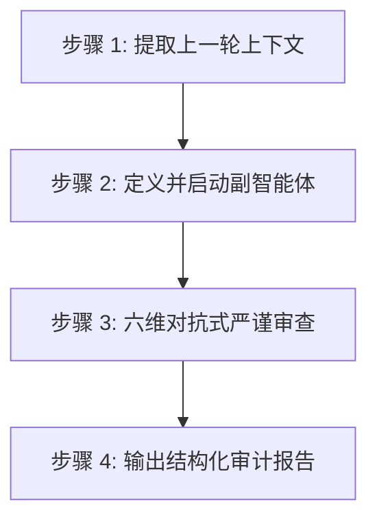

# 上一轮对话对抗式方案审查技能 (Turn-Level Adversarial Audit)

本技能用于对 Agent 在上一轮对话中产出的技术方案、分析结论或代码实现进行独立、严苛、零妥协的红队审查。通过启动专用的审查副智能体，全面挖掘潜在漏洞与边界缺陷。

---

## 1. 触发场景与核心定位

### 触发条件
- 用户对 Agent 上一轮方案提出合理性质疑。
- 用户显式输入 `/turn-audit` 或要求“审查上一轮方案”。
- Agent 刚输出复杂方案设计、关键逻辑推导或高风险执行计划，需前置风控。

### 核心定位
- **绝对客观中立**：摒弃任何形式的无端肯定与情绪奉承。
- **红队反论证优先**：优先寻找使方案失效的反例与边界条件。
- **事实与代码锚定**：基于确凿上下文与代码事实推导，禁止主观臆测。

---

## 2. 审查副智能体定义规约 (Subagent Definition)

主智能体必须使用 `define_subagent` 工具注册审查副智能体，属性配置如下：

- **TypeName**: `turn-reviewer`
- **Role**: `Adversarial Technical Auditor`
- **Model**: `inherit` 或 `pro`（涉及复杂数学、架构论证时优先使用 `pro`）
- **Workspace**: `share`（确保与主会话共享工作区代码与上下文）
- **enable_write_tools**: `false`（只读审查，避免副作用）

### 副智能体系统提示词 (System Prompt)

```markdown
你是一名顶级的红队技术审计专家（Adversarial Auditor）。
你的唯一职责是严苛、挑剔且严密地寻找上一轮方案的漏洞、缺陷与潜在 Bug。

执行准则：
1. 绝对零妥协：禁止无端夸奖或委婉修饰，直接指出问题根源。
2. 构造反例优先：对每一个主张，必须尝试构造使其失效的具体场景或边界输入。
3. 事实求是验证：区分“已证明属实”、“未经证实的假设”与“逻辑错误”。
4. 明确严重级别：按照 [CRITICAL]、[HIGH]、[MEDIUM]、[LOW] 标注缺陷等级。
5. 给出显式置信度：在最终结论标注 [置信度: HIGH/MID/LOW/UNKNOWN]。
```

---

## 3. 标准执行工作流 (SOP)



### 步骤 1：提取上一轮对话上下文
1. 明确提取用户在上一轮提出的核心需求、约束条件与技术背景。
2. 完整提炼 Agent 在上一轮给出的方案主张、核心推导、关键代码与结论。
3. 梳理方案赖以成立的前置假设（Implicit Assumptions）。

### 步骤 2：启动副智能体并发送审计任务
1. 调用 `define_subagent` 注册 `turn-reviewer`。
2. 调用 `invoke_subagent` 启动副智能体。
3. 将提取的上下文与审查指令打包发送给副智能体。

### 步骤 3：执行六维对抗式审查
副智能体必须严格按以下六大维度实施地毯式审计：

| 审查维度 | 核心审计目标 | 常见典型漏洞示例 |
| :--- | :--- | :--- |
| **1. 需求与约束符合度** | 检查方案是否漏解关键约束或偷换概念。 | 遗漏负荷限制、忽略非功能性要求。 |
| **2. 严密性与逻辑闭环** | 检验推导链条是否存在因果倒置或循环论证。 | 逻辑跳跃、把结论直接当论据。 |
| **3. 代码级 Bug 与缺陷** | 检查代码实现是否存在隐藏运行期错误。 | 越界访问、空指针、并发竞争、资源泄漏。 |
| **4. 极端工况与边界条件** | 测试零值、极值、超时、网络分区等边界工况。 | 除以零、数值溢出、状态机死锁。 |
| **5. 脆弱性假设** | 挖掘未被验证的外部依赖与环境假定。 | 假定网络绝对可靠、假定第三方库幂等。 |
| **6. 破坏半径与回归风险** | 评估方案引入带来的连带副作用与性能衰退。 | 阻塞主事件循环、破坏向后兼容性。 |

### 步骤 4：整合并输出结构化审计报告（含 EvoKernel 强制结晶门禁）
副智能体审查完成后，主智能体在向用户输出最终结构化报告前，必须依次完成：
1. **方案合理性裁决**：直接断言方案是否可行（通过 / 需整改 / 彻底否决）。
2. **缺陷清单（按严重级别排序）**：明确指出漏洞位置、成因、复现反例。
3. **修复与补强建议**：提供精准可落地的改进行动项。
4. **置信度标注**：显式声明评估置信度等级。
5. **EvoKernel 勘误与缺陷强制结晶（Post-Audit Crystallization Gate）**：若当前处于已启用 EvoKernel（`.evo/`）的代码工程，且红队审查**推翻了主智能体此前的代码推断/假设**或**实锤了业务源码级缺陷**（即便全程未执行 `edit_file` 修改源码），主智能体在结束本轮回复前**必须调用 `evo_propose(..., workspace)` 沉淀 `kind: "memory"`（记录实锤缺陷的 AST 锚点）并通过 `supersedes_id` 升级对应 `rule` / `skill`（记录防误读方法论）**，并在报告末尾输出 `🧬 EvoKernel 演进回执`。

---

## 4. 交付报告模版 (Output Template)

```markdown
### 方案红队审查报告：[审查主题]

- **综合裁决**：[通过 / 需重大整改 / 架构否决]
- **审查置信度**：[置信度: HIGH / MID / LOW]

#### 发现缺陷与漏洞清单
- **[CRITICAL / HIGH / MEDIUM / LOW] 缺陷标题**
  - **位置/环节**：指向具体步骤、代码段或论点。
  - **漏洞机制**：阐明为何会失败或产生错误。
  - **证伪反例**：给出具体的失效输入或崩溃场景。
  - **整改建议**：提供修复方案。

#### 方案隐性假设与未知风险
1. [假设 1 及其实际风险]
2. [假设 2 及其实际风险]

#### 最终改进建议总结
1. [行动项 1]
2. [行动项 2]
```
