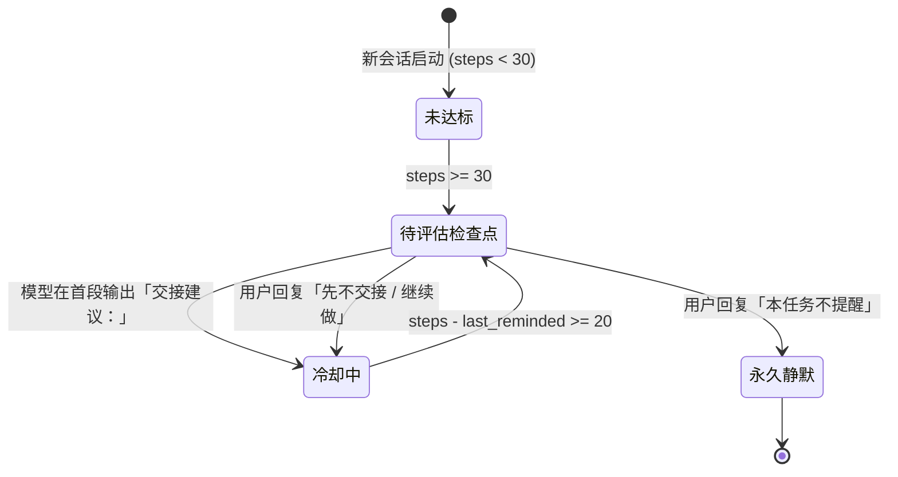

# Antigravity 宿主 Hook 运行机制与参数调优指南

本指南说明 `project-handoff` 在 Google Antigravity 运行环境下的自动检测、状态监控与审计实现原理。

---

## 一、 为什么不使用 PostCompact？
- **宿主事件模型差异**：Codex 与 Claude Code 具有底层 `PostCompact` 生命周期事件，而 Antigravity 采用 `PreInvocation`、`PostInvocation`、`PreToolUse`、`PostToolUse` 与 `Stop`。
- **Gemini 上下文模型差异**：Gemini 具备高达 1M+ 的原生上下文窗口，物理压缩发生极少。但随着会话步数增加（通常超过 25~35 步工具交互），会伴随长上下文注意力稀释（Attention Drift）、单轮响应延迟增加与历史冲突。
- **最优解方案**：通过 Antigravity 原生 `PreInvocation` 钩子读取 `transcript.jsonl`，执行**长程步数周期监控（Step-Cycle Monitor）**，并在达到阈值时通过 `ephemeralMessage` 向模型瞬时注入检查点指令。

---

## 二、 阈值配置与调优

脚本位于：[antigravity_hook.py](../scripts/antigravity_hook.py)

| 参数名称 | 默认值 | 含义与调整建议 |
| :--- | :--- | :--- |
| `INITIAL_STEP_THRESHOLD` | `30` 步 | **首次提醒阈值**。当会话步数达到 30 步后，触发首次交接评估。若偏好更紧凑的会话切换，可下调至 20~25 步。 |
| `COOLDOWN_STEPS` | `20` 步 | **防打扰冷却周期**。当模型输出过交接建议或用户暂缓交接后，至少再经历 20 步才允许下一次建议。 |
| 状态存储目录 | `~/.gemini/antigravity/handoff_state/` | 存储每个会话状态文件 `<session_hash>.json`，基于原子写操作杜绝并发冲突。 |

---

## 三、 状态机流转

---

## 四、 故障排查与重置

- **查看当前会话状态**：
  进入目录 `~/.gemini/antigravity/handoff_state/`，查看对应 session 的 JSON 文件（记录了 `step_count`、`last_reminded_step`、`muted` 状态）。
- **解除静默**：
  直接删除对应 JSON 文件，或在对话中显式输入“/project-handoff 保存”。
